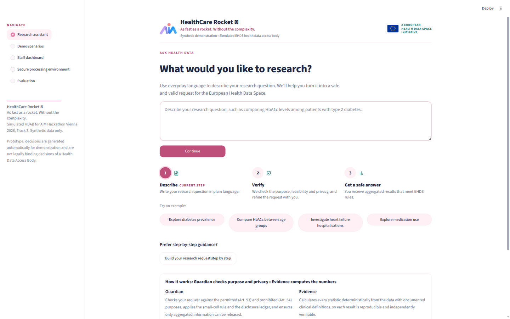
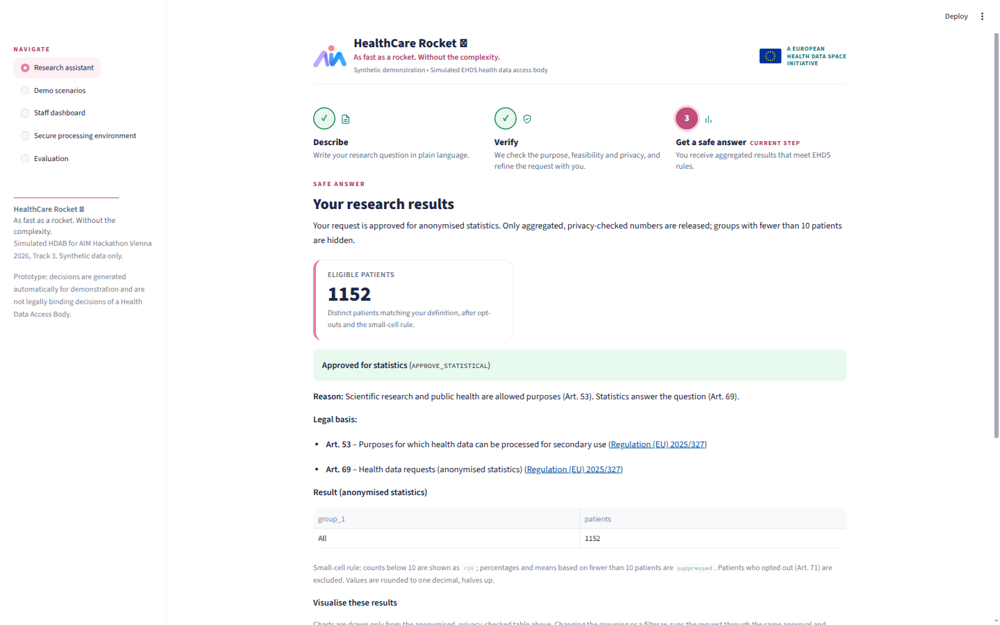
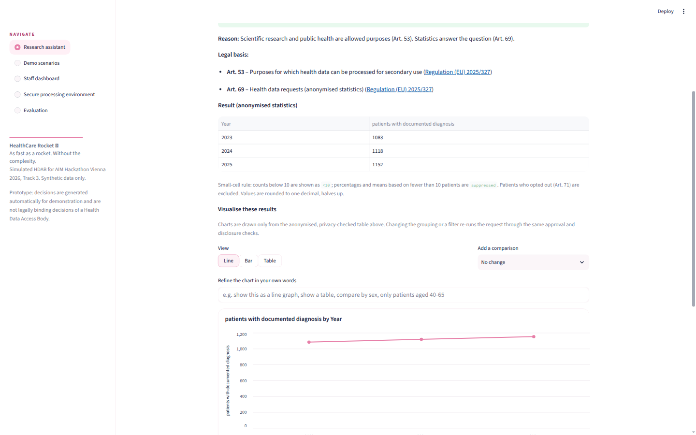
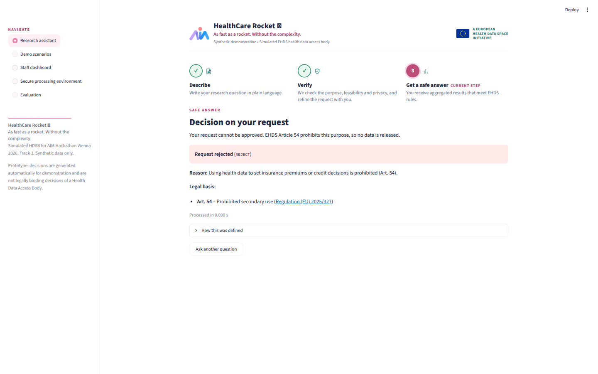

<p align="center">
  
</p>

<h1 align="center">HealthCare Rocket 🚀</h1>

<p align="center"><strong>As fast as a rocket. Without the complexity.</strong><br>
<em>From clinical questions to responsible health-data insights.</em></p>

<p align="center">
  
  
  
  
  
</p>

<p align="center">
  <a href="#watch-the-2-minute-demo">Demo video</a> ·
  <a href="#why-healthcare-rocket">Why HealthCare Rocket?</a> ·
  <a href="#a-60-second-example">Example</a> ·
  <a href="#screenshots">Screenshots</a> ·
  <a href="#legal-and-ethical-design">Legal &amp; ethical design</a> ·
  <a href="#technical-documentation">Technical documentation</a> ·
  <a href="#run-it">Run it</a> ·
  <a href="#validation-and-limitations">Validation &amp; limitations</a>
</p>

*AIM Healthcare Hackathon Vienna 2026 · Track 3: European Health Data Space · a prototype built on synthetic data*

---

**The problem.** Under the European Health Data Space (EHDS, Regulation (EU) 2025/327) a researcher who wants health data must file a formal request with a Health Data Access Body, which has to judge the *purpose* (research yes, insurance pricing no), translate clinical language into codes, compute the statistics and make sure nothing identifiable leaves the building. Today that takes legal expertise, programming skills and months of waiting.

**The solution.** HealthCare Rocket is a researcher-friendly gateway prototype for the EHDS. A researcher types a clinical question in plain English; the gateway interprets the medical terminology, asks back only when a detail changes the result, checks *why* the data is wanted, applies the privacy rules and calculates the answer deterministically from the data. Every decision is explained in plain language and cites the article it rests on.

> **An AI system that knows when to answer, when to ask, and when to say no.**

The prototype was built by a final-year medical student as the sole hackathon participant. Its ambition is to connect three things that are usually kept apart: **medical understanding**, **research usability** and **responsible health-data access**.

## Watch the 2-minute demo

> 🎬 **Video link: _coming soon_** — the final URL will be added here after upload.
> The video shows a legitimate diabetes question answered with statistics and a chart, a prohibited insurance request being rejected, and what happens when a question is ambiguous.

## Why HealthCare Rocket?

Around 10–15 teams are tackling the same challenge. This is what we chose to focus on.

| | Differentiator | What it means in practice |
|---|---|---|
| 🩺 | **Researcher-first design** | Researchers formulate medical questions in everyday language — no SQL, no JSON, no programming. A step-by-step builder and the challenge's JSON format remain available for those who prefer them. |
| 🧬 | **Clinical interpretation** | Natural-language questions become structured clinical criteria: diagnoses are mapped to **ICD-10** (16 condition concepts, e.g. type 2 diabetes → E11, plus composite sets such as cardiovascular disease), medications to **ATC** groups (17, e.g. metformin, SGLT2 inhibitors, DOACs) and laboratory values to **LOINC** (HbA1c, BMI, systolic blood pressure, eGFR). Clinically relevant defaults — "on metformin" = active on 31 Dec 2025, "hospitalised for X" = inpatient stay with X as main diagnosis, "documented by the end of each year" = cumulative, "newly diagnosed" = first recorded in that year — are stated openly on the review screen, and the researcher is asked when the wording is genuinely ambiguous. |
| 🎯 | **Purpose-aware access control** | The gateway evaluates **why** someone wants the data, not just which data they request. The research purpose is read from both the declared purpose and the question text itself ("…so that we can target residents with advertisements"). |
| 🛡️ | **Safety by design** | Permitted scientific research proceeds to statistical analysis (`APPROVE_STATISTICAL`); prohibited purposes such as insurance pricing, advertising or employment decisions are rejected (`REJECT`, Art. 54); a purpose that fits neither list is held for human review (`REVIEW_REQUIRED`) and **nothing is computed or released** until a person decides. The hold is enforced in the backend, not only in the user interface. |
| 🔀 | **Separate access pathways** | Aggregate statistical requests are distinguished from access applications for pseudonymised individual-level records. Only an application that explains why statistics are not enough (e.g. training a prediction model) is routed to a secure processing environment (`APPROVE_SPE`); otherwise the applicant receives statistics and is told why. |
| 🧮 | **Transparent calculations** | The interpreter is deterministic and rule-based; every number is computed with pandas from the dataset, passes the small-cell rule and a disclosure-ledger check, and comes with a methodology note. No generative model invents statistics — and no patient-level data ever leaves the application. |
| 🔁 | **Protection against *combinations* of answers** | A disclosure ledger remembers every released count (as one-way hashes of the patient set) and withholds a new result when it would differ from an earlier one by fewer than 10 patients — the classic "women with breast cancer: 114 / …excluding Burgenland: 112 → Burgenland has 2" differencing attack. |
| 👩‍⚕️ | **Clinical perspective** | Developed by a medical student, the prototype prioritises understandable clinical questions, meaningful statistical definitions (prevalence, incidence, cumulative counts, standard clinical bins for BMI/HbA1c/blood pressure/eGFR) and usability for researchers. |

We have not compared these features against the other teams' entries, so we do not claim they are unique — only that they work, are tested, and are documented here.

## A 60-second example

**Researcher asks:** "How many patients have type 2 diabetes?"

The application:

1. **Interprets** the question: *Type 2 diabetes → ICD-10 E11; count distinct patients* — shown on a plain-language card the researcher confirms or corrects.
2. **Collects** the researcher's name, organisation, declared purpose and requested access type (anonymised statistics or a secure processing environment), and shows everything together before submission.
3. **Evaluates** the request against the implemented EHDS-inspired authorization rules (Art. 54 first, then Art. 53).
4. **Applies** the privacy restrictions: opted-out patients are excluded, counts below 10 are hidden, the disclosure ledger checks for differencing.
5. **Calculates and displays** the aggregated result with its legal basis, methodology and — for grouped results — an interactive chart.

**Example output (derived from the synthetic dataset):**

> ✅ **Approved for statistics** (`APPROVE_STATISTICAL`, Art. 53, 69)
> **1,152** eligible patients with a documented type 2 diabetes diagnosis (ICD-10 E11), after excluding opted-out patients.

**The same question with a different purpose** — "We want to use the results to set individual health insurance premiums for our customers" — produces:

> ⛔ **Request rejected** (`REJECT`, Art. 54)
> Using health data to set insurance premiums or credit decisions is prohibited. **No statistics are calculated or shown.**

And an unclear purpose such as "commercial project" produces:

> ⏸️ **Review required** (`REVIEW_REQUIRED`, Art. 53)
> The purpose could not be matched to a permitted category; a staff member must decide. **Nothing is released.**

All example numbers in this README come from the supplied **synthetic** dataset (20,000 fictitious patients from three Austrian hospitals, 839 of them opted out) and were recomputed from the data, not typed in.

## Screenshots

| | |
|---|---|
|  |  |
| **Main interface** — one question box, three steps (Describe → Verify → Get a safe answer), example questions and a guided builder. | **Approved diabetes request** — the headline number (1,152 patients), the decision with its legal basis, the result table and the small-cell rule explained. |
|  |  |
| **Interactive visualisation** — "patients with a documented type 2 diabetes diagnosis by the end of each year, 2023–2025" as a line chart (1,083 / 1,118 / 1,152); Line, Bar and Table views plus plain-English refinements such as "compare by sex". | **Rejected insurance request** — the same clinical question, asked to set insurance premiums: `REJECT`, Art. 54, with the reason in plain language and no numbers. |

## Legal and ethical design

The prototype implements a simplified, EHDS-inspired decision procedure modelled on Chapter IV of [Regulation (EU) 2025/327](https://eur-lex.europa.eu/eli/reg/2025/327/oj/eng). Only provisions whose behaviour is actually implemented are listed.

| Provision | What the prototype does |
|---|---|
| **Art. 53 – permitted purposes** | The declared purpose and the question text are matched against permitted categories (scientific research, public health, improving care, education/teaching, policy-making, official statistics, training/testing algorithms). A match is required for approval; a purpose that matches nothing is held as `REVIEW_REQUIRED`. |
| **Art. 54 – prohibited uses** | Checked **first**. Insurance/credit decisions, advertising and marketing, decisions about employees, decisions detrimental to individuals or groups, development of harmful products (tobacco, alcohol) and re-identification lead to `REJECT`. Nothing is computed. |
| **Art. 66, 68, 73 – data permits and secure processing environments** | An access application is routed to a (simulated) secure processing environment only when it explains why statistics are not enough; otherwise it is downgraded to statistics with an explanation (Art. 66, 69). |
| **Art. 69 – health data requests (anonymised statistics)** | Statistical requests receive aggregated results only, after the small-cell rule and the disclosure-ledger check. |
| **Art. 71 – opt-out** | Patients who opted out are removed from every table when the data is loaded, so no later step can include them — in statistics or in a secure processing environment. |

**What this prototype is not.** It is **not** an officially authorised Health Data Access Body and **not** a production EHDS system. Its decisions are automatically generated demonstrations, not legal decisions. The "secure processing environment" is an **access-request workflow and a simulation** — a locked per-request folder containing only the approved cohort and record types, a manifest with `download_allowed: false`, and an export call that is blocked and audited. It is not a genuinely deployed, isolated computing environment. No claim of regulatory compliance, certification or formal security guarantee is made.

## Technical documentation

### Architecture

```
researcher question (plain English)
        │
        ▼
nl.py  ─ rule-based interpretation ─►  structured criteria (conditions, medications, labs,
        │                              age, sex, region, hospital, time, group-by, metrics)
        ▼
clarification only when a choice changes the result (medication status,
hospitalisation meaning, diabetes type, cumulative vs newly diagnosed …)
        │
        ▼
review screen: question · applicant · declared purpose · access type · interpretation
        │   (the very same request object is what the backend evaluates)
        ▼
decision.py ─ Art. 54 prohibited? ──────────────► REJECT (Art. 54)
        ├─ purpose matches no Art. 53 category ─► REVIEW_REQUIRED (Art. 53) — nothing computed
        ├─ health data request ─────────────────► APPROVE_STATISTICAL (Art. 53, 69)
        ├─ access application, records justified ► APPROVE_SPE (Art. 53, 66, 68, 73)
        └─ access application, statistics suffice► APPROVE_STATISTICAL (Art. 53, 66, 69)
        │
        ▼
pipeline.py release gate: only APPROVE_* may carry an answer or a workspace
        │
        ├─ statistics ─► engine.py (pandas, opt-outs removed at load) ─► privacy.py (small-cell
        │                rule + output check) ─► disclosure.py (differencing ledger) ─► answer
        └─ SPE ────────► spe.py (cohort-only workspace, download blocked) ─► audit.py (JSONL log)
        │
        ▼
app.py (Streamlit): decision + reason + legal basis, result table, headline number,
Altair chart (Line | Bar | Table), methodology note
```

**Three principles.** *AI interprets the question. Deterministic systems calculate the answer. Independent safeguards determine what can safely be released.* The interpreter never touches patient data and never produces a number; the engine computes; privacy, the ledger and the release gate decide what leaves.

### Main components

| Module | Role |
|---|---|
| `app.py` | Streamlit web app: **Research assistant** (question → interpretation card → review → decision and results with charts), **Demo scenarios**, **Staff dashboard** (decisions, query plans, ledger, audit log), **Secure processing environment** view, **Evaluation** (the official metrics, live). |
| `ehds_hdab/nl.py` | Deterministic natural-language interpreter: regular-expression and dictionary rules turn a question into `criteria`, with documented assumptions, unrecognised words, unsupported analyses and clarification questions. Carries grouping, measures, access pathway and purpose sentences from the question to the review screen. |
| `ehds_hdab/terminology.py` | Dictionary of medical terms → ICD-10 / ATC / LOINC code sets, with a fallback lookup in the data. |
| `ehds_hdab/criteria.py` · `parser.py` · `plan.py` | Validate structured criteria (or the challenge's free-text definitions) and turn them into a `QueryPlan`; produce the human-readable definitions shown to the researcher. |
| `ehds_hdab/decision.py` | Purpose screening in the order above; returns decision, articles, plain-language reason and purpose category. |
| `ehds_hdab/data.py` · `engine.py` · `bins.py` | Load the five CSVs once, drop opted-out patients from all tables, execute the plan per group (counts, percentages, means, per-year trends with cumulative or incident diagnoses, standard clinical bins). |
| `ehds_hdab/privacy.py` | Small-cell rule and output privacy check (see below). |
| `ehds_hdab/disclosure.py` | Persistent disclosure ledger with subset-differencing detection. |
| `ehds_hdab/pipeline.py` | Orchestration and the release gate (`RELEASING_DECISIONS`). |
| `ehds_hdab/spe.py` · `audit.py` | Simulated secure processing environment and append-only audit log. |
| `ehds_hdab/charts.py` · `viz.py` · `theme.py` | Chart plan from the released (already suppressed) table, chart-refinement commands, design tokens. |
| `ehds_hdab/providers.py` | Pluggable interpreter back-end. Default `rules` (no network). Optional Ollama/Mistral adapters exist behind the same structured-criteria schema but are **untested in this prototype and off by default**; even if enabled they would receive only the question text, never patient data. |
| `evaluate.py` | Runs R01–R10 three times and reports the official metrics against `requests/expected.json`. |

### Technology stack

Python 3.10+, [pandas](https://pandas.pydata.org/) (data processing), [Streamlit](https://streamlit.io/) (web interface, Altair charts), matplotlib (chart rendering helpers), pytest (tests, including Streamlit's `AppTest` for end-to-end UI tests). No database server, no external APIs, no network calls in the default configuration.

### How data is loaded and analysed

`data/` contains 20,000 synthetic patients in five CSV files — patients, conditions (ICD-10), medications (ATC), observations (LOINC) and encounters. `data.py` loads them once into memory, computes age as of 31 December 2025 and removes the 839 opted-out patients from **every** table before any query runs. `engine.py` then executes the query plan with vectorised pandas for every requested group (including empty ones), using the same definitions that are shown to the researcher. Trends are computed per calendar year: a diagnosis "by the end of each year" counts patients with a diagnosis recorded on or before 31 December of that year; "newly diagnosed" counts first recorded diagnoses within the year.

### Statistical disclosure controls

- **Small-cell rule:** counts below 10 (including 0) are shown as `<10`; percentages whose numerator or denominator is below 10, and means of fewer than 10 patients, are shown as `suppressed`; values are rounded to one decimal, halves up; every requested group is shown.
- **Output check:** every released answer is scanned for patient identifiers, record lists and unsuppressed small values.
- **Disclosure ledger:** each released count cell is stored (on disk, as one-way hashes of the patient set — never IDs) and compared with every earlier released cell, across all applicants. If one population is contained in the other and the counts differ by fewer than 10 patients, the new result is withheld and the researcher is told why and what to ask instead; the withheld number is never displayed.
- **Charts** are drawn only from the suppressed table; patient-level chart types are refused outside the SPE.
- **SPE simulation:** a per-request folder with only the approved cohort and requested record types, a manifest with `download_allowed: false`; any export call raises `DownloadBlockedError` and is written to the audit log.

### Run it

```bash
git clone https://github.com/fruityquarrel8v/TRACK-3-ehds.git
cd TRACK-3-ehds
pip install -r requirements.txt
streamlit run app.py                      # web app → http://localhost:8501
```

Other entry points:

```bash
python evaluate.py                        # the official metrics on requests/R01–R10
python -m ehds_hdab requests/R01.json     # one request from the command line (JSON out)
python -m pytest -q                       # 213 automated tests
```

### Repository structure

```
app.py                 Streamlit application (all views)
ehds_hdab/             the gateway: interpretation, decision, engine, privacy, ledger, SPE, charts
data/                  synthetic dataset (5 CSV files) and its README
requests/              the 10 official requests (R01–R10) and expected.json
tests/                 213 tests, incl. new requests in tests/new_requests/ and UI tests
evaluate.py            official metric evaluation
assets/                AIM logo files
docs/screenshots/      the screenshots used in this README
.streamlit/config.toml Streamlit theme
.env.example           optional environment variables (documented placeholders only)
COMPLIANCE_AUDIT.md    an earlier self-audit of the authorization and privacy controls
```

### External dependencies and environment variables

None are required. Everything runs locally with the default settings. Optional variables (see `.env.example`):

| Variable | Default | Purpose |
|---|---|---|
| `EHDS_NL_PROVIDER` | `rules` | Interpreter back-end. `ollama` / `mistral` select the untested model adapters (with `OLLAMA_URL`, `OLLAMA_MODEL`, `MISTRAL_API_KEY`, `MISTRAL_MODEL`, `MISTRAL_URL`, `EHDS_NL_TIMEOUT`). Only question text would be sent. |
| `EHDS_DISCLOSURE_AUDIENCE` | `shared` | Whether the ledger compares releases across all applicants (`shared`) or per applicant. |
| `EHDS_DATA_DIR`, `EHDS_SPE_ROOT`, `EHDS_AUDIT_LOG`, `EHDS_LEDGER_PATH` | repository paths | Locations of the data, SPE workspaces, audit log and ledger. |
| `EHDS_ENABLE_EXPORTS` | unset | Shows the JSON/PNG download buttons, hidden by default for the demo. |

No secrets are stored in the repository.

## Validation and limitations

### Verified results (current version, `python evaluate.py` and `python -m pytest`)

| Check | Result |
|---|---|
| Official requests R01–R10: correct decisions and articles | **10 of 10** |
| Official requests: correct numbers | **6 of 6** |
| Privacy leaks in statistical answers | **0** |
| Consistency over 3 runs | **10 of 10** |
| Slowest answer | **0.25 s** (after a one-off data load of ≈2 s) |
| Automated tests | **213 passing** — official requests, new clinical requests, lab thresholds, medication periods, diagnosis timing, trends, differencing ledger, prohibited and legitimate purposes, prompt-injection attempts, session isolation, UI flows |
| "How many patients have type 2 diabetes?" | `APPROVE_STATISTICAL`, **1,152** patients |
| Same question, insurance-premium purpose | `REJECT`, Art. 54, no statistics |
| Ambiguous commercial purpose | `REVIEW_REQUIRED`, nothing released |
| Type 2 diabetes documented by year-end 2023–2025 | 1,083 / 1,118 / 1,152, shown as table, line and bar chart |

Expected values in the tests are recomputed independently with plain pandas; none are hard-coded into the application.

### Known limitations

- **Natural-language support is partial.** The interpreter understands the concepts in its dictionary (16 conditions, 17 medication groups, 4 laboratory tests) and a defined set of question patterns. Unknown words are reported, not guessed; analyses the engine cannot compute (odds ratios, regression, prediction, survival) are refused with an explanation rather than replaced by a count.
- **Purpose screening is pattern-based.** A cleverly disguised prohibited purpose could pass and needs a human reviewer; the staff dashboard shows `REVIEW_REQUIRED` requests but has no approve/reject action yet, so a hold is final within the prototype.
- **Disclosure protection is not complete.** The ledger detects nested subset differencing between released counts. It does not model percentages or means, combinations of three or more queries, non-nested overlaps, or external knowledge. The prototype **does not guarantee protection against all re-identification attacks**.
- **The SPE is simulated**, not a real isolated environment.
- **Synthetic data only.** The dataset is fictitious; trends exist per calendar year only, laboratory and encounter data cover 2023–2025, and age is fixed at 31 December 2025.
- **Prototype, not a legal instrument.** Decisions are generated for demonstration and are not decisions of a Health Data Access Body.

## About

HealthCare Rocket was created for the AIM Healthcare Hackathon Vienna 2026 by **Sašo Mravljak**, a final-year medical student and the sole participant for this entry — responsible for the clinical interpretation rules, the statistical definitions, the product direction and the testing of every flow. The code was implemented with AI-assisted software engineering (Devin) from those briefs.

## Vision

> **Health data should be accessible for legitimate research without making privacy an afterthought.**

HealthCare Rocket is a prototype of how future EHDS research workflows could become simpler for researchers, more transparent for everyone and more responsible by design: a gateway that understands the clinical question, understands the purpose, calculates honestly, and knows when to answer, when to ask, and when to say no.

---

<details>
<summary><strong>Appendix – the challenge as set by the organisers (Track 3)</strong></summary>

The European Health Data Space lets researchers, agencies and companies reuse health data. In each EU country, a Health Data Access Body decides every request. Approved applicants get anonymised statistics or pseudonymised records inside a secure processing environment (SPE) that they cannot download from.

**Build** an app that takes a request as JSON and (1) decides `REJECT`, `APPROVE_STATISTICAL` or `APPROVE_SPE` citing the articles, (2) computes the statistics with the small-cell rule, (3) for an SPE copies the selected patients' requested records in, reports the exact patient count and blocks downloads, (4) shows the decision and reason to applicant and staff.

**Decision order:** prohibited purpose → `REJECT`, Art. 54 · health data request → `APPROVE_STATISTICAL`, Art. 53, 69 · access application explaining why statistics are not enough (R05) → `APPROVE_SPE`, Art. 53, 66, 68, 73 · any other access application (R09) → `APPROVE_STATISTICAL`, Art. 53, 66, 69.

**Small-cell rule:** show every requested group, even if empty; counts below 10 (incl. 0) as `<10`; `suppressed` for a percentage whose numerator or denominator is below 10 and for a mean of fewer than 10 patients; one decimal, halves up. Leave out opted-out patients everywhere. Patient-level data stays inside the app.

**Materials:** `data/` (20,000 synthetic patients from three Austrian hospitals, five CSVs, see `data/README.md`), `requests/` (R01–R10 and `expected.json`), [Regulation (EU) 2025/327](https://eur-lex.europa.eu/eli/reg/2025/327/oj/eng), Chapter IV.

**Metrics:** correct decisions (10 of 10), correct numbers (6 of 6), privacy leaks (0), consistency over 3 runs (10 of 10), time to answer (under 60 s). The jury also tests new requests on the same data, e.g. filtering inpatient stays by main diagnosis (`primary_icd10`) or grouping by hospital (`data_holder`).

**Judging:** clinical approach and impact · technical quality and AI · execution and prototype, each 33.3 %, scored 1–10 with the metric results taken into account. Use only synthetic data.

</details>
